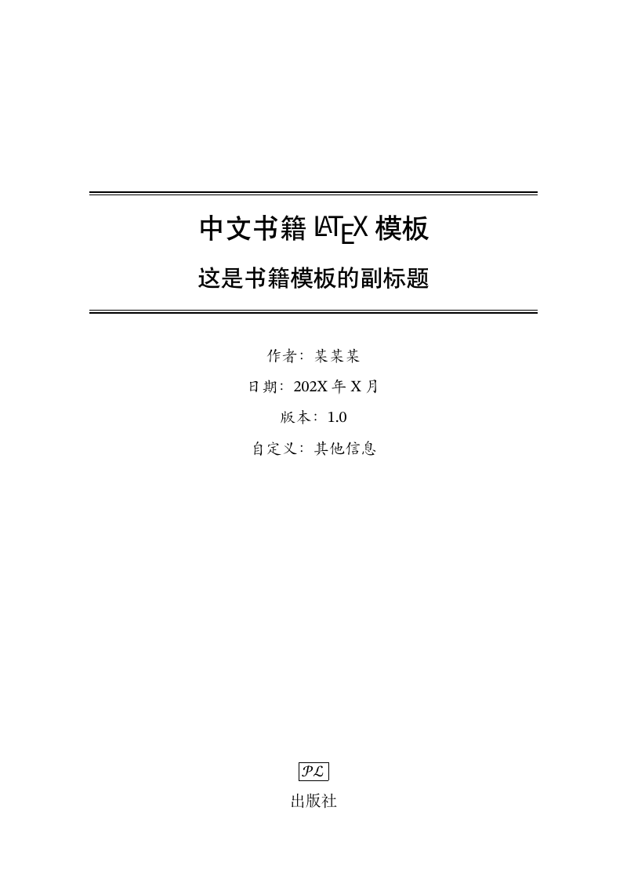
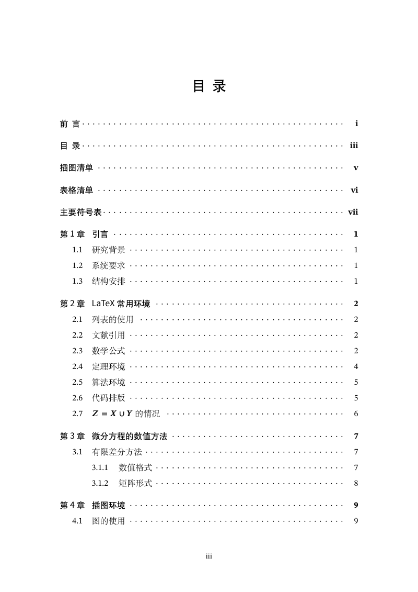
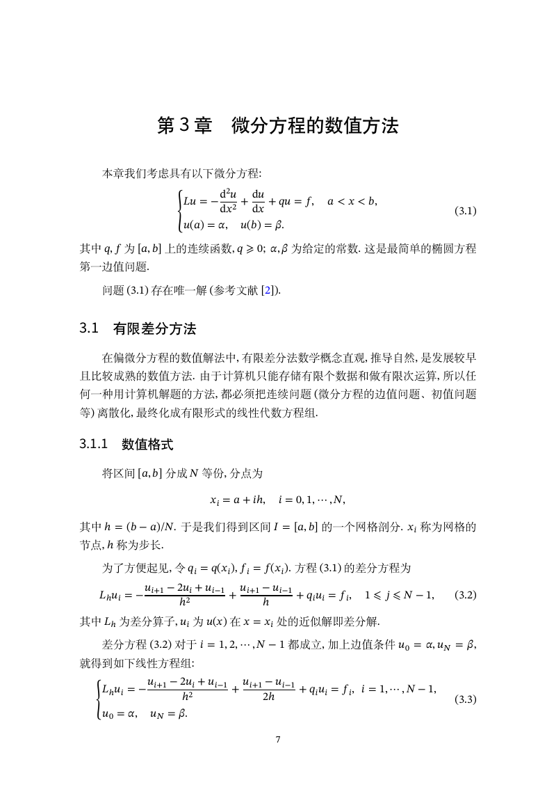
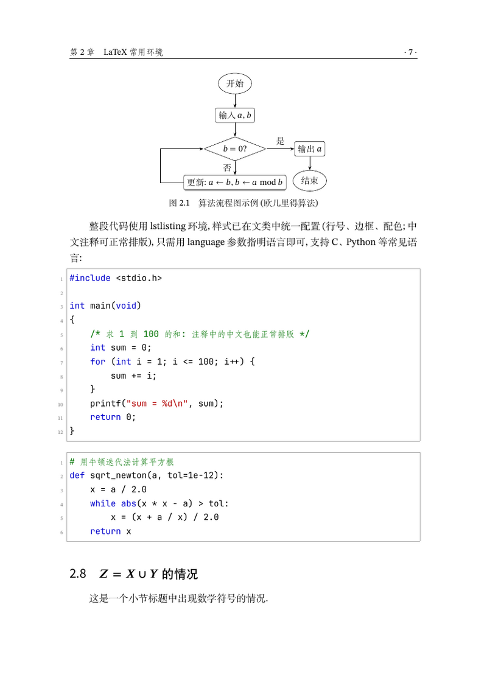
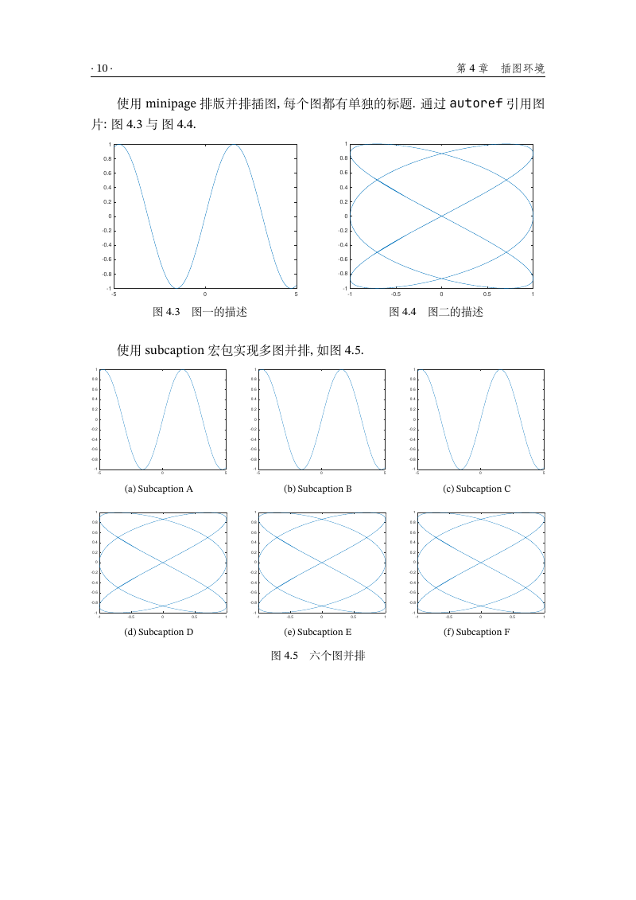
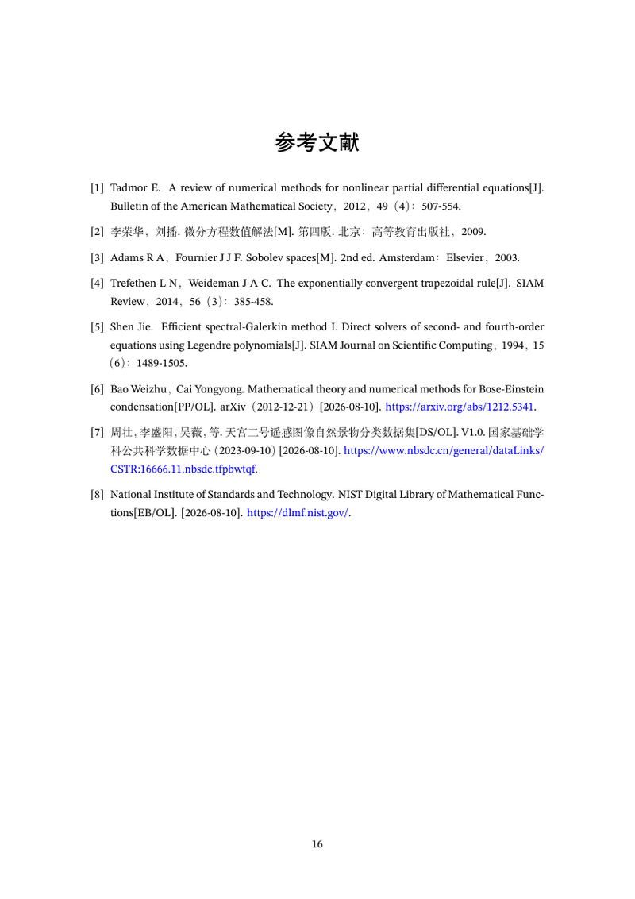

# boyogalazhcnbook

**中文书籍 LaTeX 模板**（基于 ctexbook 文类，使用 XeLaTeX 编译）

<p align="center"></p>

## 目录

- [特性](#特性)
- [快速开始](#快速开始)
- [类选项](#类选项)
- [字体](#字体)
- [编译方法](#编译方法)
- [参考文献](#参考文献)
- [排版细节](#排版细节)
- [目录结构](#目录结构)
- [效果预览](#效果预览)
- [常见问题](#常见问题)
- [致谢](#致谢)
- [许可协议](#许可协议)

## 特性

- 书籍结构齐全：封面、前言、目录、插图清单、表格清单、主要符号表、章节、附录、参考文献、索引、后记；
- 数学环境丰富：定理、引理、定义、例、推论、注、练习、假设、公理、性质、猜想等 12 种，附证明环境；数学工具齐全（amsmath、amsthm、mathtools、unicode-math）；
- 常用排版：算法与伪代码（algorithm、algpseudocode）、代码（listings，中文注释可正常排版）、子图与并排图（subcaption、minipage）、绘图与流程图（tikz）、多栏排版（multicol）、三线表（booktabs）、索引（imakeidx）；
- 参考文献符合国家标准 GB/T 7714—2025，顺序编码制与著者-出版年制均可（BibTeX，样式文件随附）；
- 中文排版细节：段首缩进 2 字（含列表项与引文内段落）、段间距与行距、章首页页码、页眉等；
- 设置分离：版式集中于 `boyogalazhcnbook.cls`，字体、宏包、参考文献等全局设置集中于 `boyogalazhcnbooksetting.tex`，便于按需调整；
- 可选类选项：`bindingoffset` 装订线、`print` 打印模式、`openright` 奇数页起章、`mathfont` 备用数学字体等；
- 基于 XeLaTeX + latexmk 一键编译；各章用 `\include` 组织，支持 `\includeonly` 只编译修改的章节；
- 自带字体方案：中文、西文、数学与代码字体全部取自仓库 `font/` 目录中的字体文件，换电脑编译无需安装任何字体（详见[字体](#字体)一节）。

## 快速开始

**注意：推荐安装 TeX Live 发行版（或 MiKTeX），并且需要使用 XeLaTeX 编译！**

```tex
\documentclass[openany,twoside,zihao=-4]{boyogalazhcnbook}  % 本模板推荐的默认选项
```

将本仓库作为起点使用即可：`boyogalazhcnbook.cls`（文类，版式主体）、`boyogalazhcnbooksetting.tex`（全局设置：字体、宏包、参考文献与索引）、`main.tex`（主文件，书籍信息与章节组织）、`chapters/`（各章节源文件）、`font/`（模板所用字体）、`reference.bib`（参考文献库）与两个 `gbt7714-2025-*.bst` 样式文件放在同一目录，修改封面信息与内容后用 latexmk 编译（见下一节）。

## 封面信息

书名、副标题、作者等封面内容都在 `main.tex` 顶部设置：

| 命令 | 说明 |
| --- | --- |
| `\title{...}` | 书名（封面主标题，最大字号） |
| `\subtitle{...}` | 副标题（可选，不需要可删除） |
| `\author{...}` | 作者 |
| `\coverimage{...}` | 封面图片（可选，如 `figures/boyogala.png`） |
| `\motto{...}` | 封面座右铭（可选，可用 `\\` 分行） |
| `\date{...}` / `\version{...}` | 日期与版本（显示在封面下方） |
| `\bioinfo{键}{值}` | 作者的其他信息（可选，显示为「键：值」） |
| `\extrainfo{...}` | 封面底部附加信息，如出版社标志与名称（可选） |

封面采用现代三栏式布局：上层为书名与副标题，中层为作者与封面图片，下层为座右铭；同时设置 `\motto` 与 `\date` 时，封面优先显示座右铭（日期与版本不再出现）。点缀色与封面字体可分别在 `boyogalazhcnbook.cls`（`boyogalagreen`）与 `boyogalazhcnbooksetting.tex`（`zhcover` 字族）中修改。

## 类选项

| 选项 | 取值 | 说明 |
| --- | --- | --- |
| `print` | — | 打印模式：封面、前言等处自动补空白页，并隐藏链接颜色 |
| `openany` / `openright` | — | 各章从任意页（默认）/ 奇数页开始 |
| `twoside` / `oneside` | — | 双面（默认）/ 单面排版 |
| `zihao` | `-4`、`5` 等 | 正文字号，默认小四号（`zihao=-4`） |
| `fontset` | `windows`、`mac`、`fandol` 等 | 中文字体集（模板默认 `fandol`；实际字体统一由 `boyogalazhcnbooksetting.tex` 指定） |
| `mathfont` | `lmodern`、`xits`、`termes`、`stix2`、`pagella` | 备用数学字体（取自 TeX Live）；默认数学字体由 `boyogalazhcnbooksetting.tex` 配置，会覆盖此选项 |
| `bindingoffset` | 长度，如 `1cm` | 装订线：双面打印时在页面内侧额外预留的宽度 |

- `mathfont` 为备用选项（使用 TeX Live 自带字体）；默认数学字体由 `boyogalazhcnbooksetting.tex` 配置，会覆盖此选项；
- 装订线建议配合 `openright` 或 `print` 模式使用，此时前置页从奇数页开始，装订边与物理页一致；
- ctexbook 文类的其他选项（如 `fontset`、`heading` 等）均可直接传给本模板。

## 字体

模板的全部字体都直接从仓库 `font/` 目录读取字体文件（不依赖系统安装、不联网），任何电脑上的排版效果一致：

| 用途 | 字体 | 位置 | 许可 |
| --- | --- | --- | --- |
| 中文正文 | Fandol 宋体（粗体、斜体配套） | `font/` | GPL v3 |
| 中文标题 | Fandol 黑体 | `font/` | GPL v3 |
| 中文斜体 / 引用 | Fandol 楷体 | `font/` | GPL v3 |
| 中文等宽 | Fandol 仿宋 | `font/` | GPL v3 |
| 西文正文 | STIX Two Text | `font/` | SIL OFL 1.1 |
| 西文无衬线 | 思源黑体（拉丁部分为 Source Sans） | `font/` | SIL OFL 1.1 |
| 封面标题 | 思源黑体（加粗，`zhcover` 字族） | `font/` | SIL OFL 1.1 |
| 数学 | STIX Two Math（粗体数学用同源的 XITS Math Bold） | `font/` | SIL OFL 1.1 |
| 代码 / 等宽 | JetBrains Mono | `font/` | SIL OFL 1.1 |

- 更换或调整字体：编辑 `boyogalazhcnbooksetting.tex` 第一节「字体设置」，把字体文件放入 `font/` 目录即可；
- STIX Two 是当前主流的现代数学字体（Times 风格的学术修订版），但暂无粗体数学字形，模板用同源的 XITS Math Bold 补足，
  向量、矩阵等的 `\boldsymbol` 可正常加粗；不需要粗体数学时，删去 `boyogalazhcnbooksetting.tex` 中的 `BoldFont = XITSMath-Bold.otf` 一行即可；
- 上表字体均为自由字体（GPL v3 / SIL OFL 1.1），可随模板公开分发；如替换为其他字体（尤其商业字体），请自行确认授权。

## 编译方法

推荐使用 **latexmk**（TeX Live 与 MiKTeX 均自带）：

```bash
latexmk            # 自动完成 xelatex/bibtex/makeindex 及多遍编译
latexmk -pvc       # 持续编译, 源文件保存后自动重编
latexmk -c         # 清理中间文件
```

也可以直接运行附带的脚本：Linux/macOS 用 `./makefiles.sh`，Windows 用 `makefiles.bat`，
两者都支持 `clean`（清理中间文件）与 `cleanall`（连 main.pdf 一起清理）。

不使用 latexmk 时，手动编译顺序为：
`xelatex main.tex → bibtex main → xelatex main.tex → xelatex main.tex`。

**提示：** 索引由 `imakeidx` 在编译时自动调用 `makeindex` 生成（TeX Live 默认设置即可）；
如果编译环境完全禁用了 shell 执行（如 `-no-shell-escape`），需手动运行 `makeindex main.idx` 生成索引。

**提速技巧：**

- 修改某一章时可只编译该章：在导言区加入 `\includeonly{chapters/chap03}`（换成相应章节文件），
  latexmk 只重排该章，显著加快预览；第一次使用前需完整编译一次，定稿前注释掉该行再完整编译一次即可。
- 正文各章使用 `\include` 组织（`chapters/chap01.tex` … `chapters/chap05.tex`、`chapters/appendix.tex`），
  上述增量编译即依赖于此。
- latexmk 会自动用 `xelatex -no-pdf` 完成中间各遍、最后用 `xdvipdfmx` 输出 PDF，多遍编译更快（无需设置）。
- 不需要编辑器的正反向定位时可加 `-synctex=0`：`latexmk -synctex=0`。

## 参考文献

文献信息写在 `reference.bib` 中。默认样式 `gbt7714-2025-numeric` 对应顺序编码制，引用格式可选
`numbers` 或 `super`（上标）；也可切换为 `gbt7714-2025-authoryear`（著者-出版年制，对应引用格式
`authoryear`）。著录规则符合国家标准 GB/T 7714—2025《信息与文献 参考文献著录规则》。
引用与样式切换方法见 `main.tex` 中相应注释。

## 排版细节

- 段落策略：每个自然段（包括节标题后的首段、列表项内与引文环境内新起的段落）首行缩进 2 个汉字
  （按 `\ccwd` 计算，随字号自动变化）；段间距约 4pt，行距 1.35 倍。
- 图题、表题居中排版（多行同样居中）；章首页页码居中置于页脚。
- 列表项之间不留额外间距；代码块带行号、单线边框与配色（关键字蓝、注释绿、字符串红），
  中文注释可正常排版。
- 脚注采用中文惯例：注文第一行随注码顶格，转行顶格。

## 目录结构

```text
boyogalazhcnbook.cls          文类文件 (版式主体)
boyogalazhcnbooksetting.tex   全局设置 (字体、宏包、参考文献与索引)
main.tex                      主文件 (书籍信息与章节组织)
chapters/                     各章节源文件
├── preface.tex               前言
├── chap01.tex … chap05.tex   第 1–5 章
├── appendix.tex              附录 A、B
├── denotation.tex            主要符号表
└── epilogue.tex              后记
reference.bib                 参考文献库
gbt7714-2025-numeric.bst      GB/T 7714—2025 顺序编码制样式
gbt7714-2025-authoryear.bst   GB/T 7714—2025 著者-出版年制样式
font/                         模板所用字体 (Fandol、STIX Two 等)
figures/                      示例插图 (PDF)
docs/images/                  README 预览图
makefiles.sh / makefiles.bat  编译/清理脚本
.latexmkrc                    latexmk 配置
```

## 效果预览

<table>
<tr>
<td></td>
<td></td>
</tr>
<tr>
<td align="center">目录</td>
<td align="center">数学公式与定理</td>
</tr>
<tr>
<td></td>
<td></td>
</tr>
<tr>
<td align="center">代码排版 (listings)</td>
<td align="center">图片与六子图并排</td>
</tr>
<tr>
<td></td>
<td></td>
</tr>
<tr>
<td align="center">参考文献 (GB/T 7714—2025)</td>
<td></td>
</tr>
</table>

## 常见问题

**编译时报找不到字体？**
模板的全部字体都在 `font/` 目录中，无需在系统里安装字体；请确认 `font/` 目录完整、并与
`main.tex` 位于同一目录（单独分发/下载时容易遗漏）。若自行改过 `boyogalazhcnbooksetting.tex` 中的
字体文件名，请对照 `font/` 下的实际文件核对。

**索引是空的？**
索引由 `imakeidx` 在编译时自动调用 `makeindex`（需要允许 shell 执行，TeX Live 默认允许）；
若编译时禁用了 shell 执行，请手动运行 `makeindex main.idx` 后重新编译。

**要打印装订成书？**
使用 `print` 模式并设置装订线，例如：
`\documentclass[print,openright,zihao=-4,bindingoffset=1cm]{boyogalazhcnbook}`。

## 致谢

本模板最初基于 Liutao Tian 的 [zhbook](https://github.com/andy123t/zhbook) 项目开发。在此基础上，
本项目经过系统性的重构与完善——自带全套字体（无需安装）、GB/T 7714—2025 参考文献样式、
更丰富的数学/绘图/多栏排版支持、更细致的排版处理——已发展成为独立的中文书籍模板体系。
谨向原始项目及其作者致以诚挚的谢意。

## 许可协议

本项目基于 MIT 许可协议发布，详情见 [LICENSE](LICENSE)。

模板所用字体均为自由字体（Fandol：GPL v3；STIX Two、思源黑体、JetBrains Mono：SIL OFL 1.1），
许可文本见 `font/` 目录中相应文件。
